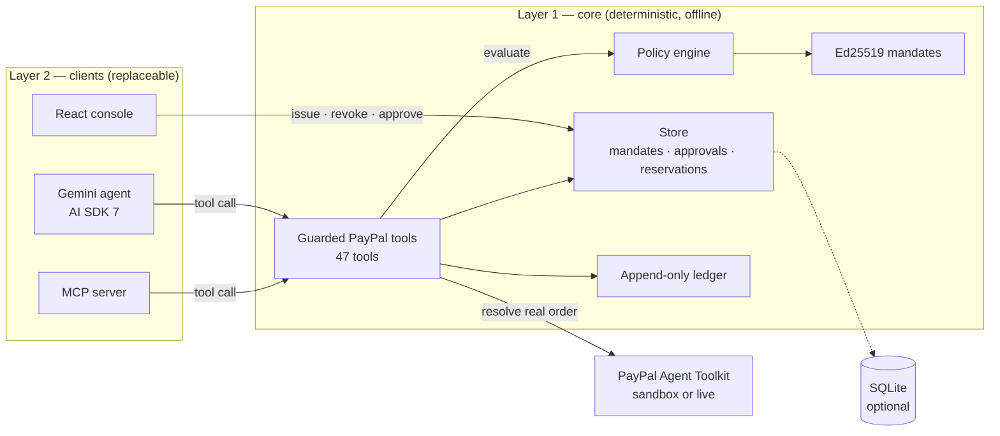
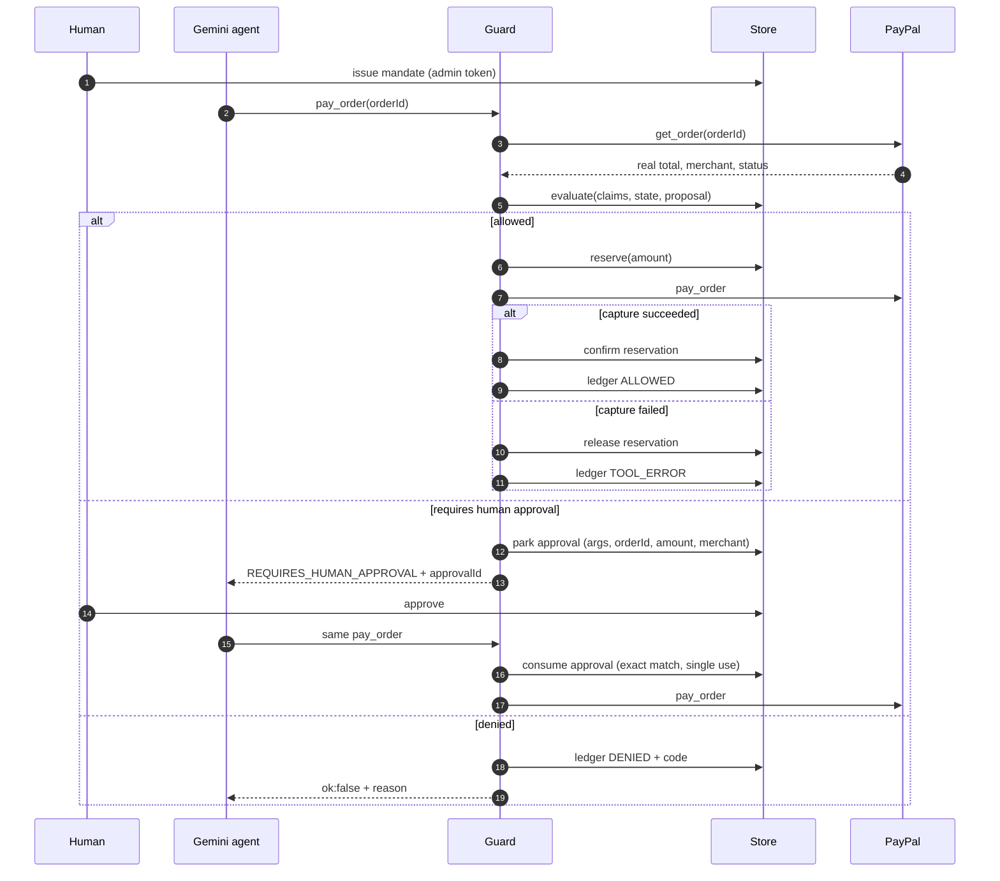

# Architecture

Agent Mandate separates **authority** from **agency**.

- **Layer 1 — core** is deterministic, has no LLM and makes no network calls.
  Every security property lives here.
- **Layer 2 — clients** is replaceable: the Gemini agent, the React console,
  the MCP server and the CLI scripts all sit on top of the same guarded tools.

The model may choose a tool and its arguments. It cannot change the mandate,
read the signing key, or reach PayPal except through the guard.

## Component map

## Trust boundaries

| Boundary | What crosses it | Control |
| --- | --- | --- |
| Model → guard | A tool name and untrusted arguments | Tool allowlist, amount resolution, policy |
| Guard → PayPal | Only an allowed call | Synchronous budget reservation, then execution |
| Human → authority | Issue, revoke, approve | Admin bearer token, `timingSafeEqual` |
| Merchant → mandate | A signed envelope, verification only | Ed25519 public key |
| PayPal → app | Webhook deliveries | PayPal signature verification before recording |

The model never receives `ADMIN_TOKEN`, `MANDATE_SIGNING_KEY` or the PayPal
client secret. That is what stops an agent from approving its own escalated
payment.

## One agent run

An escalation is not a failure. It is a payment waiting on the human who set the
threshold. The approval is bound to the exact payment and consumed on use.

## Policy order

`src/core/policy.ts` evaluates in a fixed order and returns on the first
failure:

1. Signature over the canonical claims.
2. Claims well-formed and unexpired.
3. Mandate not revoked.
4. Tool known and classified as `read`, `spend` or `mutate`.
5. Merchant allowlist and denylist.
6. Category allowlist.
7. Amount present, integer and positive.
8. Currency matches the mandate.
9. Per-transaction ceiling.
10. Transaction-count limit.
11. Cumulative budget.
12. Approval threshold → escalate.
13. Settle: allow.

Every rule that ran is attached to the decision, so the ledger explains *why*,
not just *what*.

## Budget accounting

Money is integer minor units. Two counters surround the budget:

- `spendToDate` — money that has actually moved.
- `reservedToDate` — money held for calls that are in flight.

`effectiveRemaining = budget - spendToDate - reservedToDate`.

A committing call (`pay_order`, `record_payment_for_invoice`) reserves budget
**synchronously before** the network call. Success confirms the reservation;
failure or an exception releases it. This is the double-spend fix: policy
evaluation alone can pass twice, a reservation cannot.

Invariant: after every run, `spendToDate` equals the sum of ledger entries
marked `committed`. The test suite asserts it after allowed, denied, escalated
and failed captures, and after two concurrent captures compete for the same
budget.

## Approval binding

A parked approval stores:

- the mandate id and action,
- the exact amount and normalized merchant,
- the order id, when there is one,
- the raw tool arguments, so the approved call executes exactly as proposed.

To release, the returning call must match every field, and `consumeApproval`
deletes the approval in the same synchronous step. A different order, amount or
merchant cannot reuse it, and a second call finds nothing. The concurrency test
fires two approve calls at once and asserts exactly one execution.

## Runtime modes

| Mode | PayPal | Gemini | Writes | Use |
| --- | --- | --- | --- | --- |
| `live` | Real sandbox or live toolkit | Yes | Yes | Local demo, `check:live` |
| `simulated` | Tool doubles with the real schemas | Yes | Yes | Tests and recording |
| `replay` | None | None | Refused with `409` | Hosted demo |

Replay serves `replays/demo-run.json`, recorded by `npm run record`. Each frame
is a deep-cloned snapshot captured at the moment the state changed. Playback
does not re-run the model or the guard, and the UI labels the session as a
recording. `npm run demo` builds the console and serves this recording with no
environment variables at all; `npm run check:demo -- <url>` audits a running
instance, including the read-only refusal, which is answered before
authentication so it is `409` even when no admin token exists.
`npm run verify:recording` checks the Ed25519 signature offline against the key
embedded in the file and rejects a widened copy; CI runs it on every push.

The recording also embeds the SPKI public key it was signed with. A hosted
server boots with its own ephemeral key, so `/api/mandate/public-key`,
`GET /api/mandates/:id/verify` and `POST /api/verify-mandate` use the embedded
recording key when serving a replay. That is why a visitor can verify the
mandate on screen against the key the demo publishes, and why a widened copy
of the same envelope still fails.

## Persistence

The default store is in memory, which keeps the demo inspectable and makes every
wake start clean. `STORE_BACKEND=sqlite` writes one consistent snapshot through
`src/core/persistence.ts` (`node:sqlite`) and restores it on boot. Replay
deliberately ignores SQLite.

## File map

| Path | Responsibility |
| --- | --- |
| `src/core/mandate.ts` | Canonical claims, Ed25519 signing, legacy HMAC verification, expiry |
| `src/core/policy.ts` | Deterministic rule engine; no I/O |
| `src/core/store.ts` | Mandates, spend, reservations, approvals, trust, persistence |
| `src/core/ledger.ts` | Append-only decision log |
| `src/core/canonical.ts` | Stable JSON serialization for signatures and hashes |
| `src/paypal/guard.ts` | Wraps all 47 toolkit tools; resolves amounts, enforces, records |
| `src/paypal/simulated.ts` | Tool doubles built from the real toolkit schemas |
| `src/paypal/webhook.ts` | PayPal webhook parsing and signature verification |
| `src/agent/` | Gemini adapter and system prompt; no policy logic |
| `src/server/` | Express API, SSE, replay player, demo seed |
| `src/mcp/` | The same guarded tools over MCP stdio |
| `src/web/` | React console and AG Grid ledger |
| `tests/` | 194 tests across 18 files |

## Why this shape

The boundary is the product. A wrapper around `if (amount > limit)` would put
the check in the same trust domain as the model. Here the mandate is a signed
artefact, the check is deterministic, and the ledger records both permission and
refusal. Swapping Gemini for another provider changes the demo, not the
guarantee.
